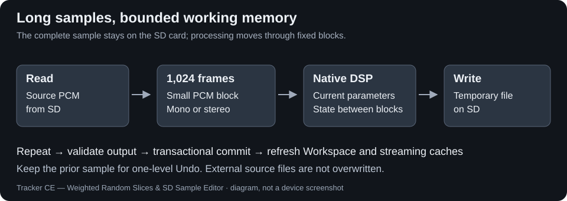
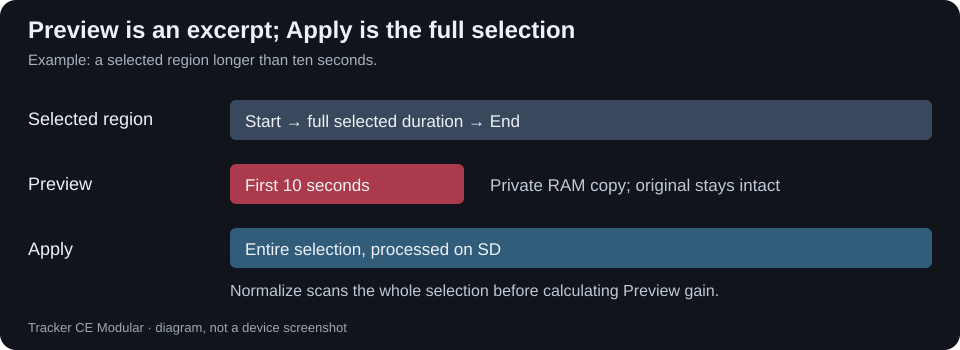
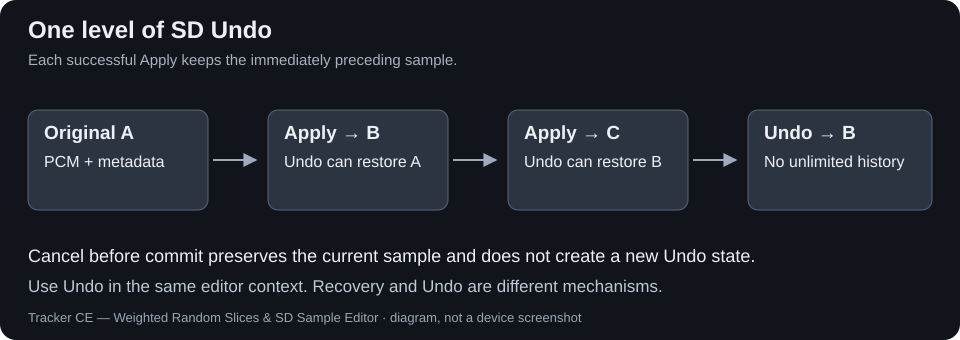

# Sample Editor SD — long-sample editing

Edit long Tracker+ samples using the familiar Sample Editor, without loading the complete file into RAM. This optional module is independent of WR2.

[Download Beta 1](https://github.com/Psygoo/tracker-ce/releases/tag/modular-b1) · [Project overview](../../README.md)

## Automatic mode selection

Small samples keep the native RAM workflow, Preview and Undo. When a sample exceeds the editor's RAM-editing limit, the editor automatically uses the SD backend. On Tracker+ the threshold is `EDIT_BUFF_SIZE / 2 = 1,966,080 frames` (about 44.6 seconds at 44.1 kHz).

The red **LONG SAMPLE · SD STREAMING MODE** indicator appears only in SD mode. It is independent of the native title/sample name and moves into the free area above the waveform when the title bar has no room. Page indicators remain visible. The SD effect list contains only supported effects, in native order; internal effect IDs are unchanged. Switching repeatedly between short and long instruments rebuilds the appropriate list.

## Use the same effect controls

Select an effect, set **Start/End**, open its Settings when available, then Preview or Apply. No duplicate SD effect entries are added. Processing reads and writes **1,024-frame blocks**, preserving native DSP state between blocks where required.

### Supported effects

| Effect | Long-sample Apply | Long-sample Preview |
|---|---|---|
| Stereo to Mono | Entire selected region; mono conversion retains the complete frame count | Up to 10 s |
| Normalize (Normalizer), Amplifier | Entire selection | Up to 10 s |
| Overdrive, Bitcrusher | Entire selection | Up to 10 s |
| Equalizer, Limiter, Compressor | Entire selection | Up to 10 s |
| Crop | Keep the selected region | No new Preview control |
| Reverse, Fade In, Fade Out | Selected region | No new Preview control |

Other effects and Modular plugins are not exposed in the long-sample list. Small samples retain the original complete list. Mono/stereo and data outside the selection are preserved where the operation permits; Crop deliberately changes duration, and Stereo to Mono deliberately changes channel count.

## Preview and Apply are different

**Preview** processes a private RAM excerpt: the full selection if it is at most 10 seconds, otherwise its first 10 seconds (441,000 frames). It does not change the instrument, slices, loops, original PCM or files. Insufficient temporary memory is reported safely; the excerpt is not silently shortened. Repeating Preview uses the current parameters. Changing context cancels/releases it.

Normalize scans the **entire selection** to find the peak before processing the audible excerpt. Stateful effects retain continuity throughout the excerpt; applicable stereo effects keep both channels.

**Apply** processes the **whole selection**, even when it is hours longer than Preview. Large operations take time and need free card space for output and protection files.

## Example: a long stereo sample with slices → mono

1. Select the existing instrument and open **Sample Editor**. Check the red SD indicator.
2. Select **Stereo to Mono** and enter Settings.
3. Set **Source** to **Merge L+R** for `(L + R) / 2`, or choose **Left Only**, **Right Only**, or the native **Side L-R** option. **Gain** remains available (-12 to +6 dB). Default Source is Merge L+R and default Gain is 0 dB.
4. Set Start/End as required; use Preview to listen to at most 10 seconds.
5. Press Apply and wait for completion. The sample stays in the same instrument slot, becomes mono, and remains available immediately in Workspace. Frame count, sample rate, slice points, loop points and other parameters are retained for this conversion; WR2 groups and weights are retained when WR2 is enabled.
6. Use Undo immediately if needed. Save the project normally to persist the edit; no extra success or Save popup appears.

The original external WAV/PTI is not overwritten. A partial mono conversion mixes the selected region and retains the original left-channel material outside it; it does not leave a stereo instrument with mixed channel layouts.

## Undo, Cancel and recovery

**One-level SD Undo** restores the PCM and instrument metadata immediately before the latest successful Apply. A second successful Apply replaces that history: Apply → Apply → Undo returns to the result of the first Apply. Use Undo on the effect that performed the edit; availability is tied to the current instrument, effect and sample identity. Leaving the editor/changing context discards the session history. It is not a persistent multi-step Undo across projects or reboots.

**Cancel** before the commit boundary returns directly to the complete editor, silently. It preserves the current sample and does not create a new Undo entry. During final commit, the operation must finish the safe transaction rather than interrupt it halfway.

Temporary output, verified backups and transaction markers protect promotion and recovery; startup recovers interrupted transactions before loading Workspace. Real read/write/full-card errors remain visible. Keep the SD card inserted while an operation is running; recovery is a safeguard, not a substitute for project backups.

Do not infer WR2 membership solely from an unchanged slice count. See the [Crop/Undo compatibility note](../releases/CROP_COMPATIBILITY.md) for the reported Beta 1 hardware result and the differing structural path found in code/tests.

## Memory and limitations

- Tracker+ only. The Original/Mini backend is not enabled.
- No whole-file PCM buffer; job memory is borrowed from the checked editor workspace/free sample-pool tail. All 48 instruments are considered when checking occupancy.
- Stereo 10-second Preview needs 1,764,000 PCM bytes plus bounded DSP/bookkeeping storage. Safe refusal is expected if the required memory is not available.
- Native DSP kernels/parameters are reused. Existing SD-specific differences remain: indexed SD fades avoid accumulating float error, SD Reverse avoids a native RAM endpoint defect, silence normalization is safe, and Bitcrusher avoids signed-shift undefined behaviour while preserving PCM/hold boundaries. These are not new Beta 1 algorithm changes.
- No native project, PTI or WAV format changes. Ordinary project Save/Open remains necessary; Undo is session-local.

Enable `TRACKER_CE_ENABLE_SD_MONO=1 TRACKER_CE_ENABLE_SD_EDITS=1` with `make plus`, independently of `TRACKER_CE_ENABLE_WR2`. [Build options](../../README.md#build-your-configuration) · [Validation](../releases/modular-b1.md) · [Developer tests](../../tests/README.md).
