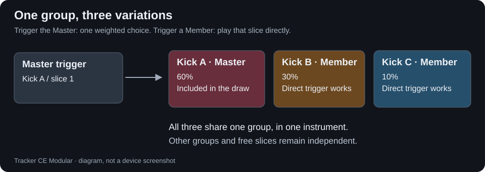
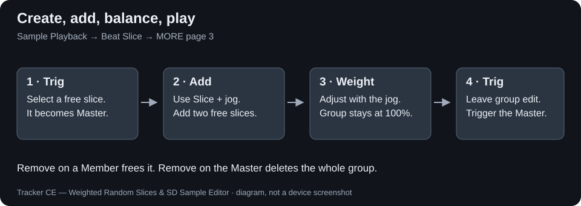
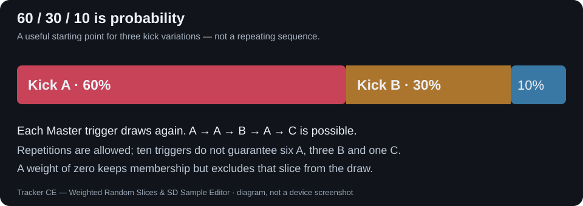

# WR2 — Weighted Random Slices

WR2 adds controlled variation to **Beat Slice** on Tracker+. Put a few related sounds into one instrument, group their slices, then decide how often each sound should be chosen.

[Download Beta 1](https://github.com/Psygoo/tracker-ce/releases/tag/modular-b1) · [Project overview](../../README.md)

## A group has one Master

A group belongs to one instrument and contains one **Master** and zero or more **Members**. Each slice belongs to at most one group. The Master is also one of the candidates.

- Trigger the **Master**: WR2 draws one slice from the group using its weights.
- Trigger a **Member** directly: that exact slice plays.
- Trigger a free slice: normal CE playback.
- Use the direct-selection **S2** effect: direct slice selection takes precedence over WR2, without a WR2 random draw.

This is **not round-robin**. Repetitions are allowed. A slice at 60% is more likely over many triggers; there is no fixed order or guaranteed quota in a short phrase. Stereo channels share one choice for each logical trigger.

## Open WR2 and make a group

1. Select a sample instrument with slices and set **Sample Playback → Beat Slice**.
2. Press **More** until the third page appears. Its controls are **Slice, Trig, Add, Remove, Weight**. The waveform stays visible.
3. Select a free slice with **Slice** and the jog. Press **Trig**: it becomes the Master, initially at 100%, and group editing starts.
4. Press **Slice**, turn the jog to another free slice, then press **Add**. Repeat for further Members.
5. Select a slice in that group, press **Weight**, then turn the jog to change its percentage.
6. Press **Trig** again to leave group editing. Trigger the Master from a pad or the sequencer to hear the variation.

To edit an existing group, select its Master or one of its Members and press **Trig**. A red Trig control indicates the editing session. Weight is available during that session; outside it, selecting Weight does not enter weight editing. The interface remembers whether Slice or Weight was last used inside Trig.

### Add, Weight and Remove

| Control | What it does |
|---|---|
| **Slice** | Select a slice with the jog; selection and normal waveform navigation remain native. |
| **Trig** | Create a group on a free slice, enter an existing group, or finish the current group-edit session. It is not the pad's audio trigger. |
| **Add** | Add the selected free slice to the active group, initially at 10%; other weights rebalance. A slice in another group is refused. |
| **Weight** | Adjust the selected group's slice from 0 to 100%; the remaining weights rebalance automatically. |
| **Remove** on a Member | Free that Member and rebalance the remaining group. |
| **Remove** on the Master | Delete the entire group; other slices become free. |

Weights are whole percentages and always total **100% per group**. Zero is valid: the slice remains a Member but is not randomly chosen. A group containing only its Master stays at 100%. Rebalancing uses deterministic largest-remainder (Hamilton) rounding; ties use the lower slice index. Add can refuse a change that would round an existing positive weight down to zero.

A slice from a different group cannot be edited as part of the current group. The validation message can be dismissed by normal WR2 interaction; choosing a valid group slice also clears it. Leave Trig before choosing another group to edit.

## Example: three kick variations, 60 / 30 / 10

Slice 1 contains the main kick, slice 2 a slightly different attack, and slice 3 an accent.

1. Select slice 1 and press Trig to create its group.
2. Use Slice + jog to select slice 2, press Add; select slice 3, press Add.
3. In Weight, set slice 2 to **30%**, slice 3 to **10%**, then slice 2 to **30% again**. Because every edit rebalances its peers, this sequence produces **60 / 30 / 10** from a newly created three-slice group. Check all three values.
4. Leave Trig. Place repeated notes for slice 1 in the pattern. WR2 chooses a kick for each trigger.

The main kick should dominate over time. To force the accent, trigger slice 3 directly. Ten Master triggers are not guaranteed to produce six main kicks, three alternatives and one accent.

## Markers and pad LEDs

Master markers are **red**, Member markers **orange**; free slices retain the native colours. While editing, markers belonging to other groups are dimmed. Master pads use the configured front-light level; current-group Members are dimmer, other groups dimmer again, and free slices faint. Brightness follows the global pad setting and LED gamma steps, so low global brightness can make levels look similar.

## Save, reopen and move instruments

Save and Save As write `wr2_groups.wr2` inside the project. Open and automatic Workspace recovery restore validated groups. New projects and projects without valid WR2 data start without groups.

- **Move slice cut points:** groups and weights are retained while slice references remain valid.
- **Load WAV into an existing slot:** native slices and valid WR2 groups are retained.
- **Load PTI:** replaces the old instrument and its groups; a valid companion restores imported groups, otherwise the old groups are cleared.
- **Instrument Copy:** copies the source groups independently.
- **Portable PTI:** copy the `.pti` and adjacent `<full PTI filename>.w2i` together. If renaming the PTI, rename its companion to match. The PTI content hash is checked; the original project sidecar is not required for that adjacent companion.

Do not delete sidecars when moving projects. Insert/remove/rebuild operations can invalidate slice membership; structural remapping is not provided. For Crop/Undo, see the [Beta 1 Crop compatibility note](../../docs/releases/CROP_COMPATIBILITY.md), which separates reported hardware results from the structural code path. There is no blanket promise that every destructive edit retains groups.

## Build and test

Enable `TRACKER_CE_ENABLE_WR2=1` for `make plus`. The default is off; Sample Editor SD is independent. No automatic demonstration groups are created. [Build matrix](../../README.md#build-your-configuration) · [Tests](../../tests/README.md).
